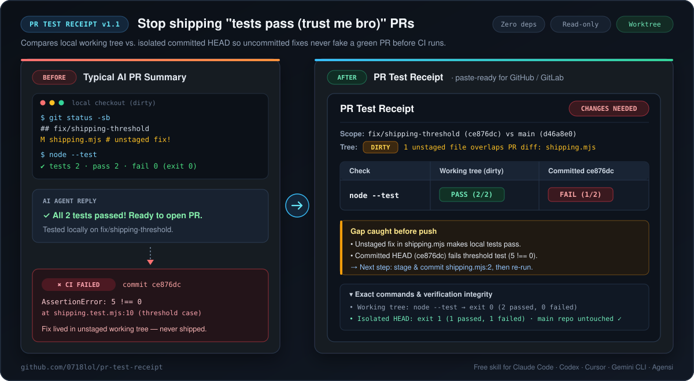

# PR Test Receipt

[](https://github.com/0718lol/pr-test-receipt/actions/workflows/ci.yml)
[](https://github.com/0718lol/pr-test-receipt/releases)
[](LICENSE)

**Stop shipping "works on my machine" PRs.**

`PR Test Receipt` is a zero-dependency AI coding agent skill for **Claude Code, Codex CLI, Cursor, Gemini CLI, Windsurf, and Agensi**. Before you open or push a pull request, it compares your branch against its base, runs targeted local checks, separates dirty working-tree runs from committed `HEAD`, and generates a **paste-ready GitHub/GitLab Test Receipt**.

<p align="center">
  
</p>

---

## Why This Exists

AI coding agents routinely tell you **"All tests pass! Ready for review."** right before CI turns red because:

- The fix that made local tests pass is still **unstaged or untracked** in your working tree.
- A new helper file was imported locally, **never `git add`ed**, and breaks on committed `HEAD`.
- A filtered test command exited `0` while running **`0` tests** (or skipping the relevant case).
- A formatter or code generator **mutated the tree mid-run** after the last commit.
- Local tests passed, while a **required CI gate** never ran.

### Before vs. After (Real Local Git Scenario)

**What an AI assistant usually writes:**
> ✅ Ran `node --test` — all 2 tests passed. Ready to open PR!  
> *(Fails in CI because the fix in `shipping.mjs` was never staged.)*

**What `PR Test Receipt` outputs (paste-ready for GitHub/GitLab):**

> ### PR Test Receipt
>
> **Verdict:** Changes needed · **Scope:** `fix/shipping-threshold` (`ce876dc`) vs `main` (`d46a8e0`, local snapshot) · **Working tree:** Dirty (1 unstaged file overlapping PR diff)
>
> | Check | Working tree (dirty) | Committed `ce876dc` | Gap / Impact |
> | --- | --- | --- | --- |
> | `node --test` | PASS (2/2) | FAIL (1/2) | `shipping.mjs` holds the unstaged fix; committed `HEAD` fails `includes the threshold in free shipping` |
>
> **Next step before review:**
> - Stage and commit `shipping.mjs:2`, then re-run `node --test` on the clean commit.
>
> <details>
> <summary>Exact commands & observed output</summary>
>
> - Working tree (`ce876dc` + unstaged `shipping.mjs`): `node --test` → exit `0` (`tests 2: 2 passed, 0 failed`)
> - Isolated committed `HEAD` (`ce876dc`): `node --test` → exit `1` (`tests 2: 1 passed, 1 failed` — `AssertionError: 5 !== 0` at `shipping.test.mjs:10`)
>
> </details>

---

## Install

### Option 1: Install from Agensi (Recommended)
Install **PR Test Receipt** directly from [Agensi](https://agensi.io) once live on the marketplace.

### Option 2: Download Release ZIP or Clone
Download `pr-test-receipt-1.1.zip` from [GitHub Releases](https://github.com/0718lol/pr-test-receipt/releases), or clone directly into your agent's skills directory:

```bash
# Claude Code / Codex / Gemini CLI / Cursor (adjust to your agent's skills path)
git clone https://github.com/0718lol/pr-test-receipt.git ~/.claude/skills/pr-test-receipt
```

---

## Usage (Natural Prompts)

Just ask your coding agent naturally before pushing or opening a PR:

- *"Am I ready to open a PR?"*
- *"Run a pre-PR check and write the Testing section for my PR."*
- *"Verify my branch before pushing — make sure the committed changes actually pass."*
- *"发 PR 前帮我检查一下，生成一段可直接贴进 PR 的测试说明。"*

---

## What's Inside

| File | Purpose |
| --- | --- |
| [`SKILL.md`](SKILL.md) | Agent workflow, safety guardrails, anti-false-pass rules, and trigger guidance |
| [`scripts/preflight_snapshot.py`](scripts/preflight_snapshot.py) | Zero-dependency, strictly **read-only** Python 3 script emitting deterministic JSON: `HEAD`, base/merge-base resolution, ahead/behind counts, committed-vs-dirty **overlap files**, whitespace/conflict checks, before/after `state_hash`, and CI/PR-template discovery |
| [`scripts/verify_head_worktree.py`](scripts/verify_head_worktree.py) | Runs checks against committed `HEAD` inside an isolated temporary detached `git worktree` (hooks disabled, timeout enforced, secret redaction, `0`-test and missing-dep detection, guaranteed cleanup) without touching your main checkout |
| [`references/receipt-template.md`](references/receipt-template.md) | Standardized, scannable GitHub/GitLab Markdown receipt templates (Clean, Dirty-Tree Split, Incomplete) with `.github/pull_request_template.md` alignment |
| [`tests/test_scripts.py`](tests/test_scripts.py) | End-to-end integration tests across 7 real Git failure & edge-case scenarios |

---

## Safety Guarantees

- **Non-destructive by default:** Never modifies tracked files, the Git index, branches, or remotes.
- **No false blame on missing deps:** Distinguishes missing gitignored third-party dependencies (`node_modules`, `.venv` → `blocked_missing_deps` / `NOT RUN`) from forgotten untracked local files (real `FAIL`).
- **Secret redaction:** Redacts common tokens and credentials from captured failure excerpts before formatting the receipt.

---

## Run Tests Locally

```bash
python3 -m unittest discover -s tests -v
```

## Related Skills

- **[skill-slim](https://github.com/0718lol/skill-slim)** — Audit always-on token costs and safely slim down AI coding agent skills across Claude Code, Codex, Gemini CLI, and Cursor.
- **[verify-engineering-work](https://github.com/0718lol/verify-engineering-work)** — Full risk-aware reliability workflow for AI coding agents.
- **[scout-before-build](https://github.com/0718lol/scout-before-build)** — Scouts GitHub repositories and design references before starting a build.

## License

[MIT](LICENSE)
